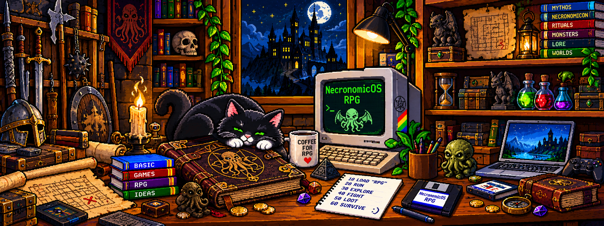
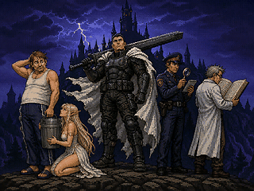
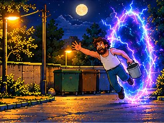
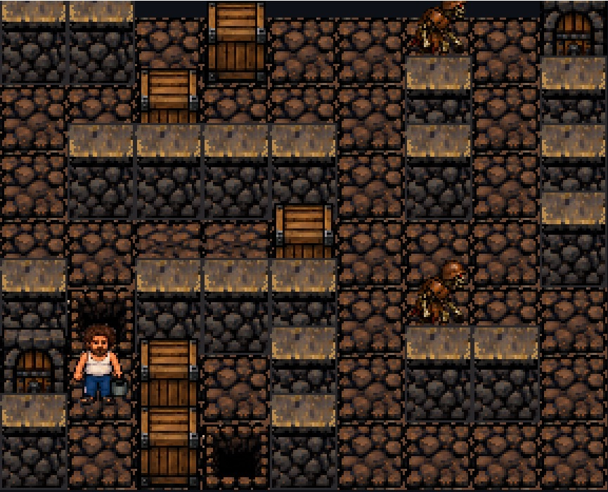
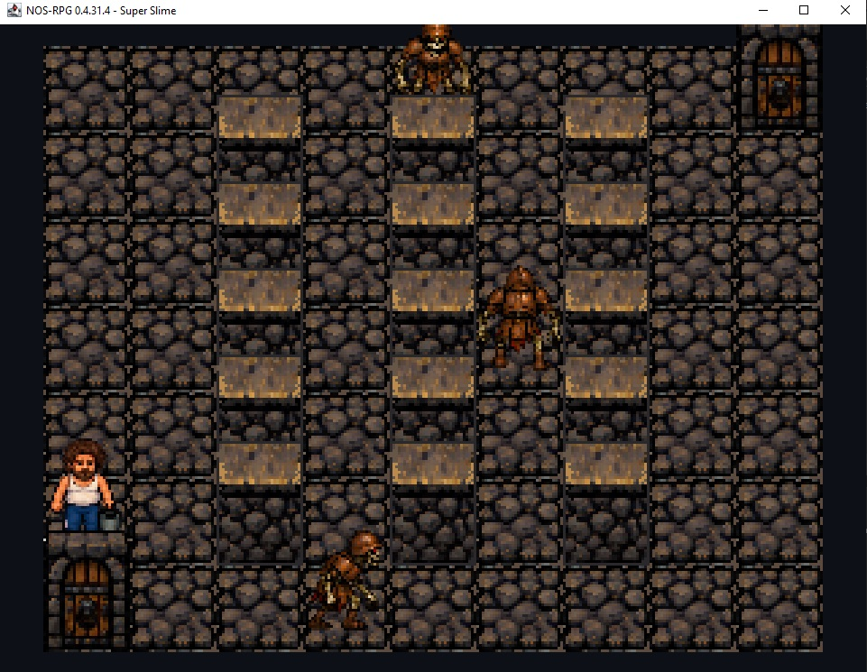
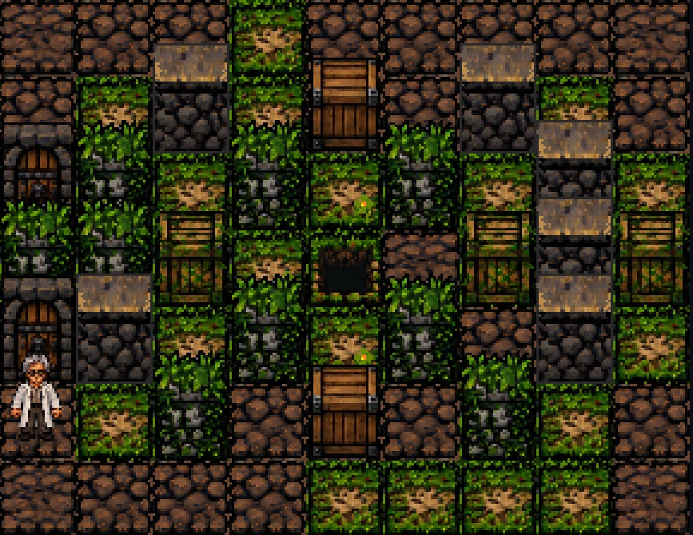
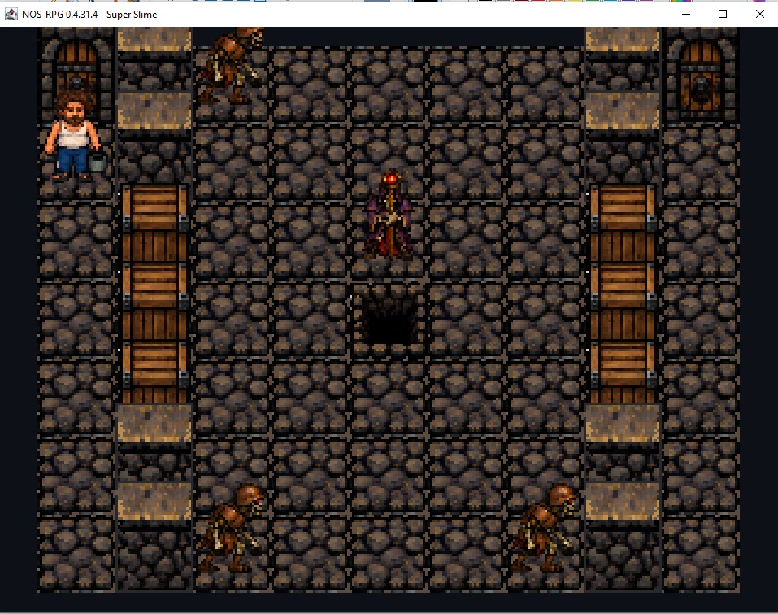

[English](#english) | [Русский](#russian)

# NecronomicOS — NOS-RPG

**A turn-based puzzle game with RPG elements.**  
**Status:** Beta / Demo · **Requirements:** Java 7 or newer · **Controls:** Keyboard

## Lands of Swords and Magick

Ever wanted to find yourself in the Lands of Swords and Magick?

Our hero did. Exactly as he was: wearing slippers and carrying a garbage bucket.

No sword, no armor, no second chance. Just one life.

But he won't be the last visitor from our world. When one hero dies, another follows. Each newcomer has different abilities, and the world remembers what came before.

You may overcome every challenge yourself. You may clear the way for whoever comes next. Or you may leave behind obstacles that make their journey all but impossible.

**Your actions outlive your hero.**

## Screenshots

| Gameplay | Gameplay |
|:---:|:---:|
|  |  |
|  |  |

## Play and create

This is a **beta/demo**, not a finished release. It includes keyboard-controlled turn-based challenges and a **level editor**. Modify existing levels or create your own and send them to the author — your level might make it into the final game.

The repository includes the Java modules, game assets, sprites, level data and source code. Java 7 or newer is required to run the game; the Windows installer is distributed separately.

**Modules:** `NecronomicOS_Menu.jar`, `Catacombs.jar`, `Catacombs-Level-Editor.jar`.

**Latest published release:** 0.5.46.8 Beta / Demo (Windows, Linux, macOS). Download the game and installers from [Releases](https://github.com/ma-beast/NOS-RPG/releases).

**Tested installers:**

- Windows XP SP3 (Pentium III)+
- Linux: Debian/Ubuntu x86/x86-64.
- macOS 10+

Requires Java 7 or newer. The Windows installer includes OpenJDK 7. The macOS and Linux installers automatically download a compatible Java version from public repositories if Java 7 or newer is not already installed. An internet connection is required for the download.

**Good luck — and have fun!**

**Author:** Mikhail Zverev / MA-BEAST

[Русский](#russian) | [↑ Top](#top)

---

# NecronomicOS — NOS-RPG

**Пошаговая логическая игра с элементами RPG.**  
**Статус:** Бета / Демо · **Требования:** Java 7 или новее · **Управление:** Клавиатура

## Lands of Swords and Magick — Земли Меча и Магии

Хотели бы попасть в Земли Меча и Магии?

Вот герой игры — попал. Прямо как был: с мусорным ведром и в тапочках.

Ни меча, ни доспехов, ни права на ошибку. У него всего одна жизнь.

Но он не последний пришелец из нашего мира. После гибели одного героя появляется следующий. У каждого свои способности, а мир сохраняет последствия действий предшественников.

Можно пройти все испытания самому. Можно расчистить и упростить дорогу тем, кто придёт следом. А можно оставить после себя такие препятствия, что дальше не пройдёт никто.

**Последствия твоих решений переживут твоего героя.**

## Скриншоты

| Игровой процесс | Игровой процесс |
|:---:|:---:|
|  |  |
|  |  |

## Игра и редактор уровней

Это **бета/демо**, а не окончательный релиз. В игре — пошаговые испытания, логические задачи и персонажи с разными способностями. Управление с клавиатуры.

**В комплект входит редактор уровней:** можно изменять существующие карты и создавать новые. Присылайте свои уровни автору — возможно, именно ваш попадёт в финальную версию игры!

В репозитории находятся игровые JAR-модули, исходники, спрайты, ресурсы и данные уровней. Для запуска требуется Java 7 или новее; Windows-инсталлятор распространяется отдельно.

**Модули:** `NecronomicOS_Menu.jar`, `Catacombs.jar`, `Catacombs-Level-Editor.jar`.

**Последний опубликованный релиз:** 0.5.46.8 Beta / Demo (Windows, Linux, macOS). Скачать игру и установщики можно в разделе [Releases](https://github.com/ma-beast/NOS-RPG/releases).

**Проверенные инсталляторы:**

- Windows от XP SP3 (Pentium III)
- Linux: Debian/Ubuntu x86/x86-64.
- macOS от 10 (Intel x64).

Требуется Java 7 или новее; в комплекте Windows-инсталлера идёт Open-JDK_7, Mac и Linux инсталлеры скачивают доступную на вашей системе версию из открытых репозиториев (нужен интернет) если у вас не установлена Ява-7+

**Всем добра! Удачи в прохождении!**

**Автор:** Михаил Зверев / MA-BEAST

[English](#english) | [↑ Наверх](#top)
